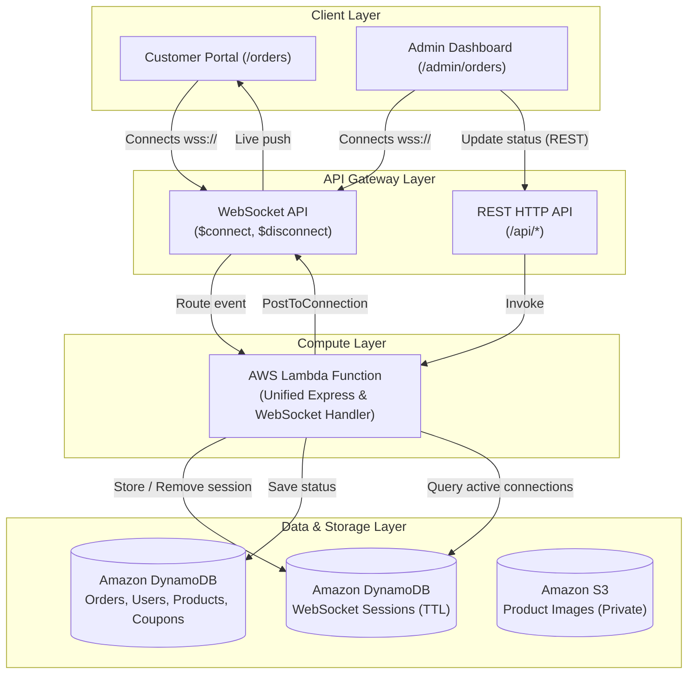

# 🛒 Shopiee - Serverless E-Commerce Platform

A modern, cloud-native full-stack e-commerce web application featuring real-time bidirectional order updates, secure cloud media storage, role-based administration, and an event-driven serverless architecture.

---

## 📖 Project Overview

**Shopiee** is an e-commerce platform designed to scale effortlessly on serverless cloud infrastructure:
* **Customer Experience**: Instant search, responsive product catalog, coupon promotions, cart management, checkout with payment gateway simulation, and real-time order status tracking.
* **Admin Dashboard**: Live metrics, product catalog management with private S3 image uploads, coupon code controls, and real-time order lifecycle tracking.
* **Serverless Real-Time Updates**: Eliminates client polling by utilizing WebSocket connections managed via AWS API Gateway and DynamoDB session tracking.

---

## 🛠️ Tech Stack

* **Frontend**: React 19, Vite, Tailwind CSS, Lucide Icons
* **Backend API**: Node.js, Express, Serverless-Express wrapper
* **Cloud & Serverless**:
  * **AWS Lambda**: Scalable, pay-per-use execution environment
  * **AWS API Gateway**: HTTP API for REST routing & WebSocket API for real-time events
  * **Amazon DynamoDB**: Low-latency NoSQL database for users, products, orders, coupons, and active socket sessions
  * **Amazon S3**: Private cloud bucket for secure product assets with presigned URL generation
* **Hosting**: Vercel (Frontend SPA) + AWS Serverless (Backend & Database)

---

## 🏛️ System Architecture



---

## 📂 Project Structure

```text
UserManagement-AWS/
├── README.md
└── UserManagement/
    └── my-react-app/
        ├── backend/
        │   ├── config/              # DynamoDB & AWS SDK clients
        │   ├── controllers/         # Business logic (auth, orders, products, payments)
        │   ├── middleware/          # JWT authentication, role checks, image upload
        │   ├── repositories/        # DynamoDB data access objects & queries
        │   ├── routes/              # Express API route declarations
        │   ├── scripts/             # Table creation & packaging utilities
        │   ├── services/            # WebSocket broadcasting, email, S3 presigning
        │   ├── lambda.js            # Unified AWS Lambda entrypoint
        │   ├── server.js            # Express application configuration
        │   ├── websocketHandler.js  # WebSocket $connect, $disconnect handlers
        │   └── package.json
        └── frontend/
            ├── public/              # Static assets
            ├── src/
            │   ├── components/      # Reusable UI components & layouts
            │   ├── config/          # API & WebSocket client configuration
            │   ├── context/         # Auth & Cart state contexts
            │   ├── pages/           # Storefront & Admin views
            │   └── utils/           # Custom hooks (e.g., useRealtime)
            ├── index.html
            ├── package.json
            └── vite.config.js
```

---

## 🚀 Setup & Local Development

### Prerequisites
* **Node.js**: v18 or higher
* **npm**: v9 or higher
* An **AWS Account** (if deploying cloud infrastructure)

### 1. Clone the Repository
```bash
git clone https://github.com/<your-username>/<your-repo-name>.git
cd <your-repo-name>/UserManagement/my-react-app
```

### 2. Backend Setup
1. Navigate to the backend directory and install dependencies:
   ```bash
   cd backend
   npm install
   ```

2. Create a `.env` file in `backend/`:
   ```env
   PORT=5000
   NODE_ENV=development
   JWT_SECRET=your_super_secret_jwt_key
   
   # AWS Configuration
   AWS_REGION=your-aws-region
   AWS_ACCESS_KEY_ID=your_access_key_id
   AWS_SECRET_ACCESS_KEY=your_secret_access_key
   
   # DynamoDB Table Names
   DYNAMODB_USERS_TABLE=UserManagementAWS-Users
   DYNAMODB_PRODUCTS_TABLE=UserManagementAWS-Products
   DYNAMODB_ORDERS_TABLE=UserManagementAWS-Orders
   DYNAMODB_COUPONS_TABLE=UserManagementAWS-Coupons
   DYNAMODB_WS_CONNECTIONS_TABLE=UserManagementAWS-WebSocketConnections
   
   # S3 & WebSocket Configuration
   S3_BUCKET_NAME=your-s3-bucket-name
   WEBSOCKET_ENDPOINT=https://<your-ws-api-id>.execute-api.<region>.amazonaws.com/<stage>
   ```

3. Run backend locally:
   ```bash
   npm run dev
   ```

### 3. Frontend Setup
1. In a new terminal, navigate to the frontend directory:
   ```bash
   cd ../frontend
   npm install
   ```

2. Create a `.env` file in `frontend/`:
   ```env
   VITE_API_URL=http://localhost:5000
   VITE_WEBSOCKET_URL=http://localhost:5000
   ```

3. Start the Vite development server:
   ```bash
   npm run dev
   ```
   Open `http://localhost:5173` in your browser.

---

## ☁️ Cloud Deployment Guide

### 1. Backend (AWS Lambda & API Gateway)

1. **Package the Lambda Deployment Artifact**:
   Inside `UserManagement/my-react-app/backend`, build the production bundle:
   ```bash
   npm run package:lambda
   ```
   This generates `lambda-deployment.zip` containing all production runtime dependencies.

2. **Deploy to AWS Lambda**:
   * Create or open your Lambda function (Node.js 20.x runtime).
   * Upload `lambda-deployment.zip` via **Upload from $\rightarrow$ .zip file**.
   * Configure your environment variables in Lambda Configuration:
     * `JWT_SECRET`
     * `AWS_REGION`
     * `WEBSOCKET_ENDPOINT` *(format: `https://<api-id>.execute-api.<region>.amazonaws.com/<stage>` without `/@connections`)*
     * Table and Bucket references.

3. **Configure API Gateway Triggers**:
   * **HTTP API**: Route all traffic (`$default` or `/{proxy+}`) to the Lambda function.
   * **WebSocket API**: Route `$connect`, `$disconnect`, and `$default` routes to the same Lambda function.

4. **IAM Role Permissions**:
   Ensure the Lambda execution role has policies granting:
   * Read/Write on DynamoDB tables.
   * Put/Delete on the private S3 bucket.
   * `execute-api:ManageConnections` on the WebSocket API ARN.

### 2. Frontend (Vercel)

1. Push your code to your Git repository.
2. Link the repository to your **Vercel** project with the root directory set to `UserManagement/my-react-app/frontend`.
3. Add the production environment variables in Vercel Project Settings:
   ```text
   VITE_API_URL = https://<your-http-api-id>.execute-api.<region>.amazonaws.com
   VITE_WEBSOCKET_URL = wss://<your-ws-api-id>.execute-api.<region>.amazonaws.com/<stage>
   ```
4. Deploy the application.

---

## 🔄 Real-Time Event Flow

1. When a client visits `/orders`, `useRealtime` establishes a connection to the WebSocket gateway using their JWT token.
2. The Lambda `$connect` route authenticates the token and registers the connection ID in DynamoDB with a 24-hour TTL.
3. When an administrator modifies an order status, the backend performs the database update and initiates an awaited `PostToConnectionCommand` to the customer's active connection.
4. The customer's UI receives the event payload and updates the order status badge in real time without refreshing.
5. When the user navigates away or closes the tab, `$disconnect` cleans up the session from DynamoDB.

---

## 📄 License

This project is licensed under the MIT License.
