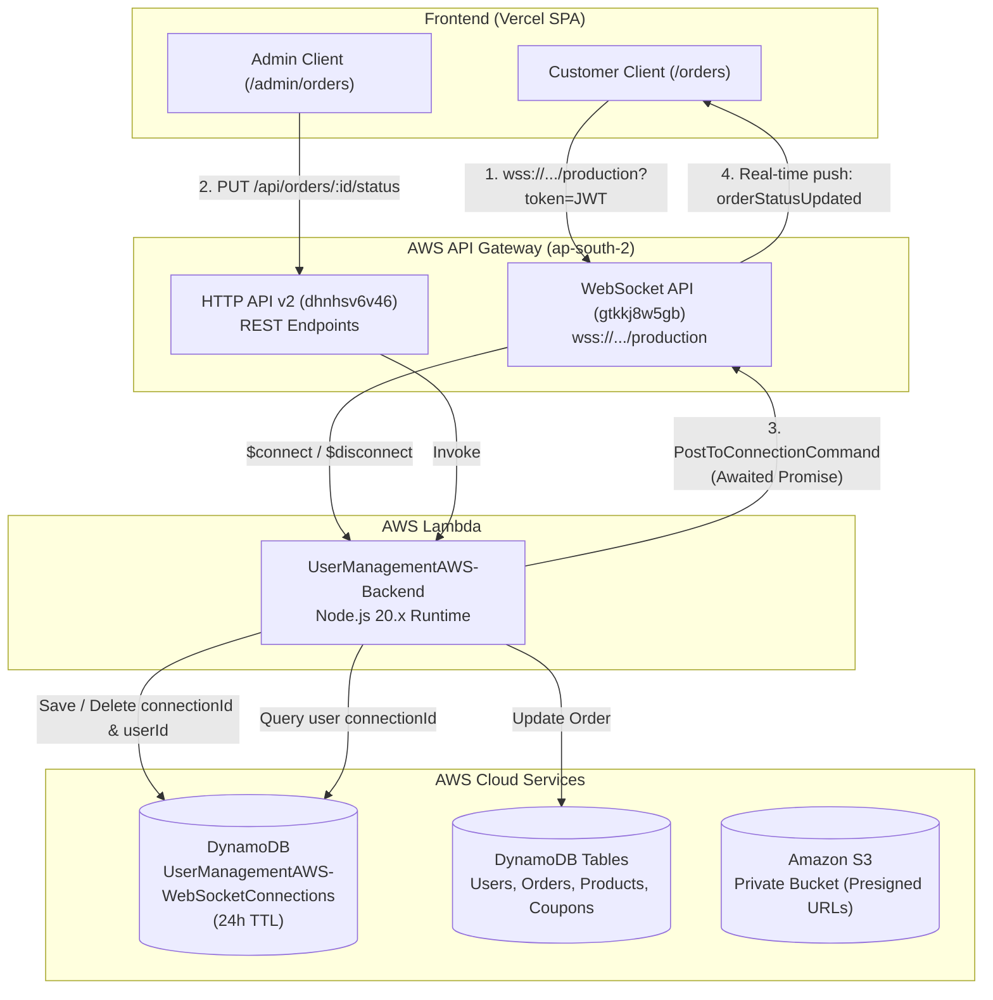

# 🛒 Shopiee - AWS Serverless E-Commerce & Real-Time WebSocket Architecture

A production-ready, cloud-native Full-Stack E-Commerce web application built with **React 19**, **Node.js**, **AWS Lambda**, **Amazon DynamoDB**, **Amazon S3**, and **AWS API Gateway WebSockets** for sub-100ms real-time status updates across customer and administrative interfaces.

---

## 🏗️ Architecture Overview

The application utilizes an event-driven serverless architecture on AWS, combined with a modern React SPA deployed on Vercel.



---

## ⚡ Real-Time WebSocket Engine

The real-time subsystem replaces traditional polling with bidirectional, serverless WebSocket push notifications.

### 1. Connection Lifecycle
* **Connect (`$connect`)**: When a user or administrator opens the web application, `useRealtime.js` initiates a WebSocket handshake to `wss://gtkkj8w5gb.execute-api.ap-south-2.amazonaws.com/production?token=<JWT>`. The Lambda handler verifies the JWT, extracts `userId` and `role`, and saves the ephemeral `connectionId` into `UserManagementAWS-WebSocketConnections` with a 24-hour TTL.
* **Disconnect (`$disconnect`)**: When a browser tab is closed or navigated away from, API Gateway triggers `$disconnect`, and Lambda removes the connection record from DynamoDB.
* **Keepalive Ping**: The client transmits an `{ action: "ping" }` heartbeat every 5 minutes to prevent AWS API Gateway's 10-minute idle connection timeout.
* **Stale Connection Cleanup (HTTP 410 Gone)**: If a client terminates unexpectedly, `@aws-sdk/client-apigatewaymanagementapi` catches `GoneException` (HTTP 410) upon message dispatch and purges the stale connection from DynamoDB automatically.

### 2. Event Types
| Event Name | Direction | Payload | Description |
| :--- | :--- | :--- | :--- |
| `orderStatusUpdated` | Server $\rightarrow$ Client | `{ orderId, status, paymentStatus }` | Dispatched to specific user connection when an order advances lifecycle (Processing $\rightarrow$ Shipped $\rightarrow$ Delivered). |
| `newOrder` | Server $\rightarrow$ Admins | `{ orderId, totalAmount, status, ... }` | Broadcast to all active admin and manager connections upon order placement. |

---

## ⚙️ Environment Variables

### Frontend (`my-react-app/frontend/.env.production` / Vercel)
| Variable | Value / Format | Purpose |
| :--- | :--- | :--- |
| `VITE_API_URL` | `https://dhnhsv6v46.execute-api.ap-south-2.amazonaws.com` | Base REST HTTP API Gateway endpoint. |
| `VITE_WEBSOCKET_URL` | `wss://gtkkj8w5gb.execute-api.ap-south-2.amazonaws.com/production` | API Gateway WebSocket URL (must start with `wss://`, no trailing slash). |

### Backend (`UserManagementAWS-Backend` Lambda)
| Variable | Correct Value | Critical Notes |
| :--- | :--- | :--- |
| `WEBSOCKET_ENDPOINT` | `https://gtkkj8w5gb.execute-api.ap-south-2.amazonaws.com/production` | **Do NOT append `/@connections`**. The AWS SDK appends this automatically. |
| `AWS_REGION` | `ap-south-2` | Target AWS deployment region. |
| `JWT_SECRET` | `your_production_jwt_secret` | Used to decode user tokens during `$connect`. |
| `DYNAMODB_WS_CONNECTIONS_TABLE` | `UserManagementAWS-WebSocketConnections` | Stores active socket sessions. |
| `DYNAMODB_ORDERS_TABLE` | `UserManagementAWS-Orders` | Stores customer orders. |
| `DYNAMODB_USERS_TABLE` | `UserManagementAWS-Users` | Stores user profiles and credentials. |
| `DYNAMODB_PRODUCTS_TABLE` | `UserManagementAWS-Products` | Stores product catalog and stock levels. |
| `S3_BUCKET_NAME` | `usermanagementaws-products-private-...` | Private bucket for catalog images. |

---

## 🔒 IAM Permissions (Lambda Execution Role)

Ensure `UserManagementAWS-Lambda-ExecutionRole` includes permissions for API Gateway management and DynamoDB:

```json
{
  "Version": "2012-10-17",
  "Statement": [
    {
      "Sid": "WebSocketManageConnections",
      "Effect": "Allow",
      "Action": [
        "execute-api:ManageConnections"
      ],
      "Resource": "arn:aws:execute-api:ap-south-2:*:gtkkj8w5gb/*"
    },
    {
      "Sid": "DynamoDBWebSocketTableAccess",
      "Effect": "Allow",
      "Action": [
        "dynamodb:PutItem",
        "dynamodb:GetItem",
        "dynamodb:DeleteItem",
        "dynamodb:Scan",
        "dynamodb:Query"
      ],
      "Resource": "arn:aws:dynamodb:ap-south-2:*:table/UserManagementAWS-WebSocketConnections*"
    }
  ]
}
```

---

## 📦 Packaging and Deployment

### 1. Build Backend Lambda Archive
To compile production runtime dependencies and build `lambda-deployment.zip`:

```bash
cd UserManagement/my-react-app/backend
npm run package:lambda
```

* Output artifact: `UserManagement/my-react-app/backend/lambda-deployment.zip` (~8.3 MB)
* In **AWS Lambda Console** $\rightarrow$ `UserManagementAWS-Backend` $\rightarrow$ **Code** $\rightarrow$ **Upload from .zip** $\rightarrow$ Select `lambda-deployment.zip` $\rightarrow$ **Save**.

### 2. Deploy Frontend to Vercel
```bash
git add .
git commit -m "feat: real-time serverless websocket order tracking"
git push origin master
```
Vercel automatically triggers a build and promotes the deployment.

---

## 🛠️ Key Architectural Traps & Solutions

### 1. The Lambda MicroVM Freeze on Unawaited Promises
* **Problem**: In Node.js Express controllers running inside AWS Lambda with `context.callbackWaitsForEmptyEventLoop = false`, calling `res.json(...)` immediately suspends the container. If `websocketService.broadcastToUser(...)` is invoked without `await`, the outbound network socket is frozen mid-flight and the message is never transmitted.
* **Solution**: All WebSocket dispatch operations in [`orderController.js`](file:///c:/Users/x512d/UserManagement-AWS/UserManagement/my-react-app/backend/controllers/orderController.js) and [`paymentController.js`](file:///c:/Users/x512d/UserManagement-AWS/UserManagement/my-react-app/backend/controllers/paymentController.js) are explicitly synchronized with `await Promise.allSettled([...])` before returning HTTP responses.

### 2. EventBridge Cron vs. ServerlessExpress (`ee.on is not a function`)
* **Problem**: When a scheduled EventBridge ping (`KeepUserManagementBackendWarm`) triggered the Lambda function, `@codegenie/serverless-express` attempted to parse the event as an HTTP socket stream, crashing with `TypeError: ee.on is not a function`.
* **Solution**: [`lambda.js`](file:///c:/Users/x512d/UserManagement-AWS/UserManagement/my-react-app/backend/lambda.js) inspects incoming payloads first. Non-HTTP and cron events immediately return `{ statusCode: 200, body: "Warm" }` and are bypassed from Express.

### 3. The `/@connections` Endpoint Doubling
* **Problem**: Setting `WEBSOCKET_ENDPOINT` to `https://.../production/@connections` causes `@aws-sdk/client-apigatewaymanagementapi` to request `/@connections/@connections/{id}`, triggering `404 Not Found`.
* **Solution**: [`websocketService.js`](file:///c:/Users/x512d/UserManagement-AWS/UserManagement/my-react-app/backend/services/websocketService.js) strips any trailing `/@connections` automatically:
  ```javascript
  const endpoint = rawEndpoint
    .trim()
    .replace(/^wss:\/\//, "https://")
    .replace(/\/@connections\/?$/, "")
    .replace(/\/+$/, "");
  ```

---

## 🧪 Verification & Diagnostics

1. **Verify Connection in Browser**:
   * Open the customer interface `/orders` $\rightarrow$ Press **F12** $\rightarrow$ **Console**.
   * Verify log: `[AWS WebSocket] Connected to real-time gateway`.
   * Under **Network** $\rightarrow$ **WS**, verify status code `101 Switching Protocols`.

2. **Verify Session in DynamoDB**:
   * In AWS DynamoDB Console, open `UserManagementAWS-WebSocketConnections`.
   * Click **Run (Scan)** while the customer tab is open.
   * Verify an active item exists with `connectionId`, `userId`, `role: "user"`, and `ttl`.

3. **Verify Real-Time Dispatch**:
   * With the customer `/orders` page visible, update an order to `Delivered` in `/admin/orders`.
   * The status badge on the customer screen updates instantly to `Delivered` without page refresh.

